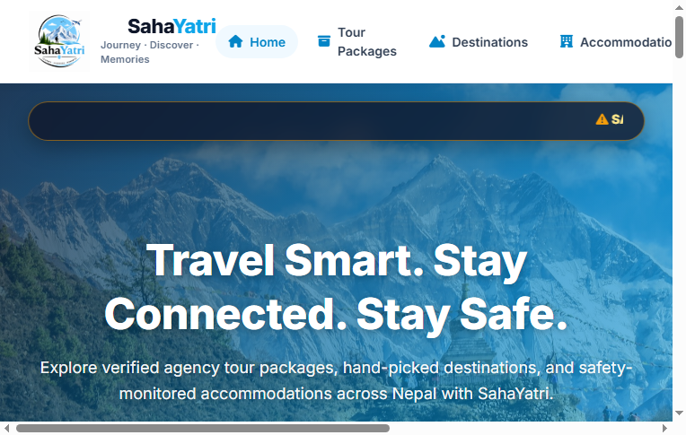
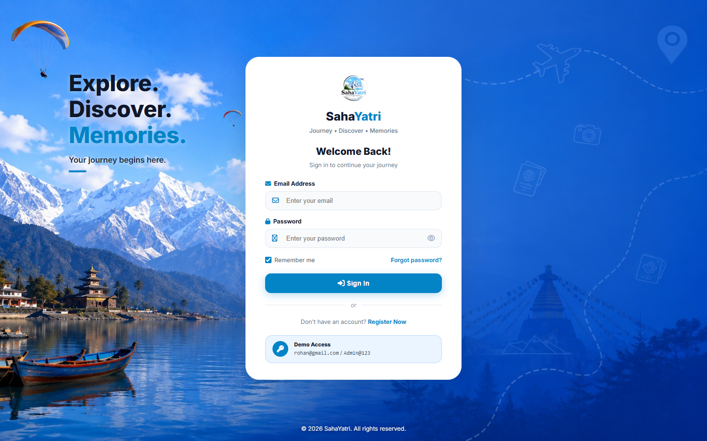
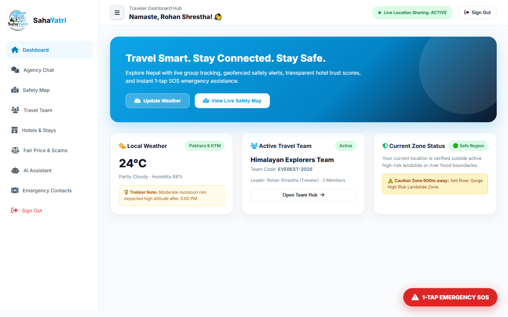
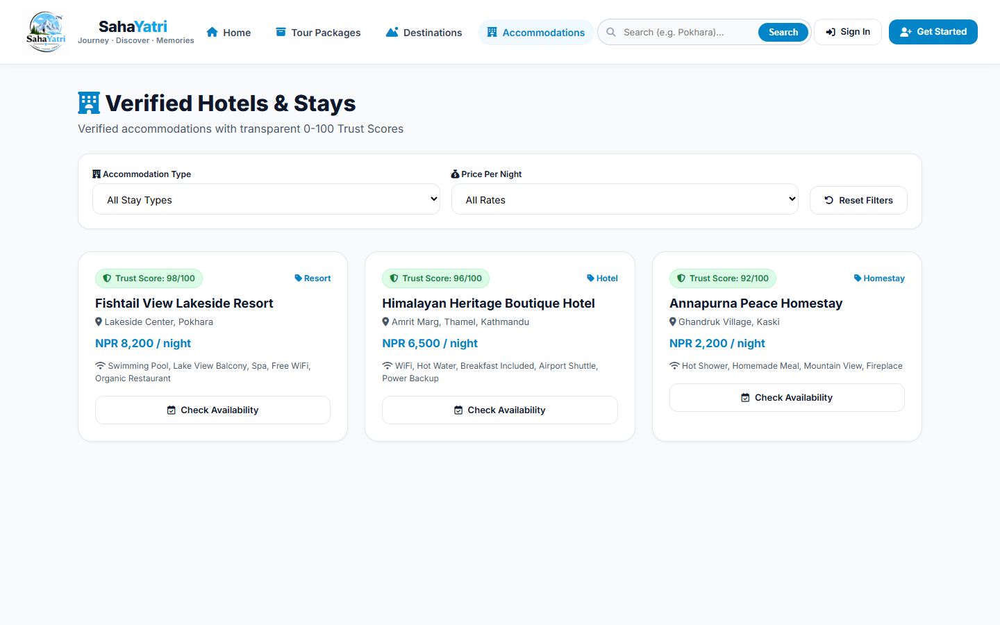
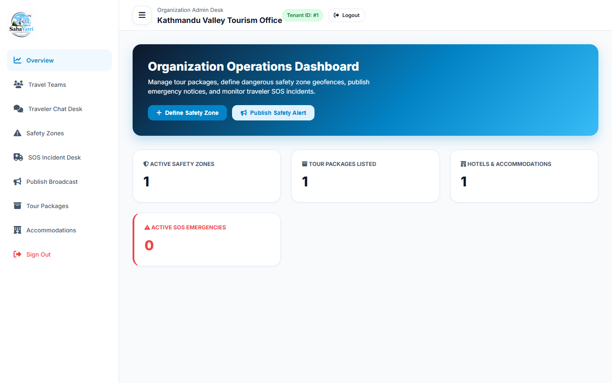
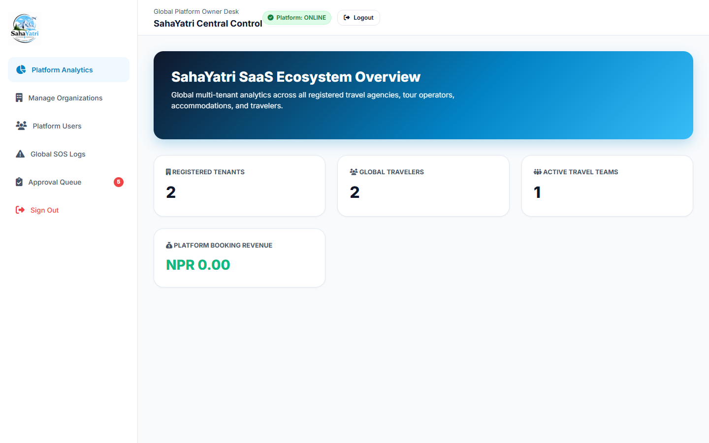
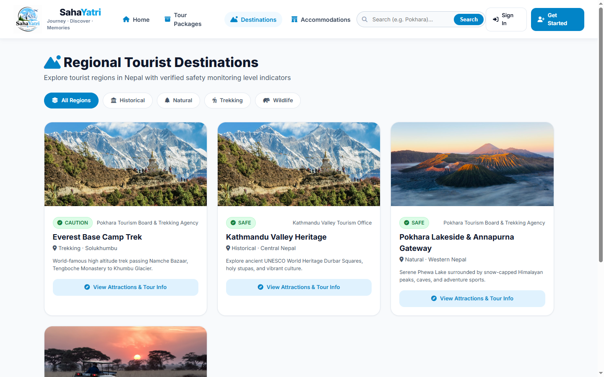
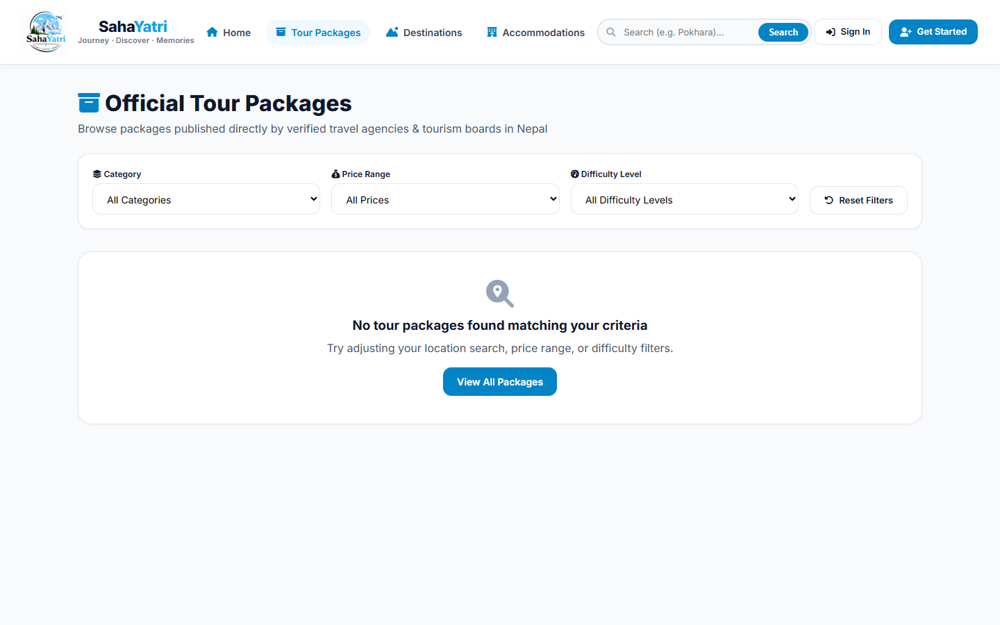

# SahaYatri (सहयात्री) – Smart Tourism Safety & Travel Companion 🏔️🇳🇵

**SahaYatri** is an end-to-end multi-tenant Smart Tourism Safety, Guide, and Travel Companion web application tailored for tourism ecosystems (such as Nepal). It empowers travelers with real-time safety monitoring, verified services, team tracking, SOS emergency alerts, scam-prevention fair price guides, and AI travel assistance, while providing tourism organizations and authorities with centralized administration tools.

---

## 🌟 Key Features

### 1. 🛡️ Tourist Safety & SOS Emergency Network
- **Instant SOS Broadcast**: One-click emergency trigger broadcasting the traveler's live GPS coordinates to emergency responders and team members.
- **Geofenced Safety Zones**: Real-time alerts for landslide areas, flash flood risks, and caution zones.
- **Verified Emergency Directory**: Direct contacts for Tourist Police, emergency medical centers, and Himalayan rescue teams.

### 2. 👥 Travel Companion & Group Coordination
- **Team Code Sharing**: Create or join travel groups with unique codes (e.g., `EVEREST-2026`).
- **Live Location Sharing**: Track group members' real-time locations on an interactive map.
- **Team Chat**: Real-time messaging hub to communicate with travel companions.

### 3. ⚖️ Fair Price Calculator & Scam Protection
- Standardized, fair pricing guidelines for taxis, trekking guides, local buses, and essential food items.
- Scam and overcharging crowd-sourced reporting with resolution tracking.

### 4. 🤖 AI Travel Assistant
- Intelligent virtual guide answering queries about travel regulations, permits (TIMS), local etiquette, weather warnings, and packing recommendations.

### 5. 🏨 Verified Destinations, Accommodations & Tour Packages
- Comprehensive destination listings categorized by safety ratings and regions.
- Verified homestays, hotels, and resorts with trust scores and genuine reviews.
- Curated tour packages with itineraries, inclusions, and capacity trackers.

### 6. 🏢 Multi-Tenant Role-Based Access Control (RBAC)
- **Super Administrator**: Platform oversight, organization management, system analytics, and safety zones.
- **Organization Admin**: Regional tourism board/agency management, destination listings, package creation, and emergency broadcasts.
- **Traveler / User**: Personalized dashboard, active bookings, team management, SOS features, and safety tools.

### 7. 📱 Progressive Web App (PWA) Ready
- PWA manifest and service worker (`sw.js`) support for offline caching and fast mobile access.

---

## 📸 System Previews & Screenshots

### 🏠 Public Portal & Authentication
| Landing Page & Live Broadcast Marquee | Sign In & Authentication Portal |
| :---: | :---: |
|  |  |

### 🧭 Traveler Safety Hub & Companion Dashboard
| Traveler Dashboard (SOS, Tracking & AI Assistant) | Verified Accommodations & Trust Score Directory |
| :---: | :---: |
|  |  |

### 🏢 Multi-Tenant Administration Consoles
| Organization Admin Dashboard | Super Administrator Platform Overview |
| :---: | :---: |
|  |  |

### 🗺️ Destinations & Tour Packages
| Destinations & Safety Risk Explorer | Curated Tour Packages Catalog |
| :---: | :---: |
|  |  |

---

## 🛠️ Technology Stack

- **Backend**: Native PHP 8+ (Modular MVC-style REST API architecture)
- **Database**: MySQL / MariaDB (InnoDB, Foreign Key Integrity, Full UTF-8 MB4 Support)
- **Frontend**: Responsive HTML5, Modern Vanilla CSS with Custom Design System, JavaScript (ES6+)
- **Mapping & Location**: Leaflet.js / OpenStreetMap Geolocation API
- **Icons & UI**: FontAwesome 6, Inter typography

---

## 📁 Project Structure

```plaintext
sahayatri/
├── api/                       # RESTful JSON API endpoints
│   ├── accommodations.php     # Accommodations API
│   ├── admin.php              # Administrative actions API
│   ├── ai.php                 # AI assistant logic
│   ├── auth.php               # User registration, login, sessions
│   ├── chat.php               # Team chat API
│   ├── destinations.php       # Destinations directory
│   ├── fair_prices.php        # Fair price database API
│   ├── location.php           # Real-time GPS location tracking
│   ├── reports.php            # Incident reporting
│   ├── safety.php             # Safety alerts & risk zones
│   ├── sos.php                # Emergency SOS alert dispatcher
│   └── teams.php              # Team creation, joining, & coordination
├── assets/                    # Static assets
│   ├── css/style.css          # Main responsive design stylesheet
│   ├── img/                   # Logos, banners, and destination photos
│   └── js/                    # Client-side scripts
├── config/                    # System configurations
│   ├── auth.php               # Authentication helper functions
│   ├── database.php           # PDO connection handler & auto-installer
│   └── helpers.php            # Security & JSON response utilities
├── includes/                  # Common UI components
│   └── navbar.php             # Dynamic navigation bar
├── screenshots/               # Application UI previews & screenshots
├── accommodation_details.php  # Accommodation view page
├── accommodations.php         # Public accommodation directory
├── admin_dashboard.php        # Organization Admin control panel
├── destinations.php           # Public destinations explorer
├── index.php                  # Landing page & public portal
├── login.php                  # User & admin authentication page
├── logout.php                 # Session termination
├── package_details.php        # Tour package details & booking
├── packages.php               # Tour package catalog
├── register.php               # User registration page
├── schema.sql                 # Complete database structure and seed data
├── setup.php                  # Web-based database installer
├── super_admin_dashboard.php  # Platform super-administrator console
├── traveler_dashboard.php     # Interactive traveler portal
├── manifest.json              # PWA manifest
└── sw.js                      # Progressive web app service worker
```

---

## 🚀 Installation & Local Setup

### Prerequisites
- [XAMPP](https://www.apachefriends.org/) (Apache + MySQL/MariaDB, PHP 8.0 or higher)
- Web browser (Chrome, Edge, Firefox, etc.)
- Git

### 1. Clone or Move the Repository
Place the project inside your XAMPP `htdocs` directory:
```bash
cd C:\xampp\htdocs
git clone https://github.com/dipeshchettry/sahayatri.git
```

### 2. Start XAMPP Services
Open the **XAMPP Control Panel** and start:
- **Apache**
- **MySQL**

### 3. Database Configuration & Setup
Open `config/database.php` and verify your MySQL database credentials (default for XAMPP is user `root` with no password):
```php
define('DB_HOST', 'localhost');
define('DB_USER', 'root');
define('DB_PASS', '');
define('DB_NAME', 'sahayatri_db');
```

#### Option A: One-Click Web Installer (Recommended)
Navigate to the web installer in your browser:
```
http://localhost/sahayatri/setup.php
```
Click **"Install & Seed Database"**. The system will automatically create `sahayatri_db` and seed all tables, demo users, destinations, accommodations, and safety zones.

#### Option B: Manual Import via phpMyAdmin
1. Open [http://localhost/phpmyadmin](http://localhost/phpmyadmin)
2. Create a new database named `sahayatri_db`.
3. Import the provided [`schema.sql`](schema.sql) file.

### 4. Access the Application
Open your browser and visit:
```
http://localhost/sahayatri/
```

---

## 🔐 Demo Accounts & Credentials

The seed data provides pre-configured accounts for testing each role:

| Role | Email | Password | Dashboard Link |
| :--- | :--- | :--- | :--- |
| **Super Admin** | `superadmin@sahayatri.com` | `Admin@123` | `super_admin_dashboard.php` |
| **Org Admin (Kathmandu)** | `ktm_admin@sahayatri.com` | `Admin@123` | `admin_dashboard.php` |
| **Org Admin (Pokhara)** | `pokhara_admin@sahayatri.com` | `Admin@123` | `admin_dashboard.php` |
| **Traveler (Rohan)** | `rohan@gmail.com` | `User@123` | `traveler_dashboard.php` |
| **Traveler (Aarav)** | `aarav@traveler.com` | `User@123` | `traveler_dashboard.php` |

---

## 🤝 Contributing

Contributions, issues, and feature requests are welcome!
1. Fork the Project
2. Create your Feature Branch (`git checkout -b feature/AmazingFeature`)
3. Commit your Changes (`git commit -m 'Add some AmazingFeature'`)
4. Push to the Branch (`git push origin feature/AmazingFeature`)
5. Open a Pull Request

---

## 📄 License

Distributed under the MIT License. See `LICENSE` for more information.
